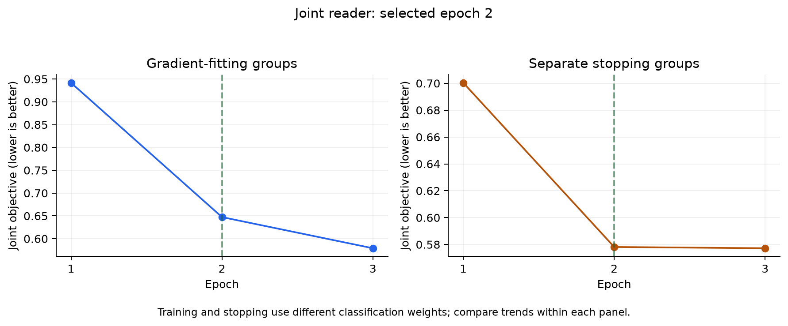

# Joint verdict and rationale reader

The requested result remains **accuracy >95% and three-class Macro-F1 >0.95 on
the original 300 SciFact validation claims**. Before this experiment, the best
saved result was **242/300, 80.6667% /0.795974**. Strict accuracy >95% requires
at least 286 correct claims: 44 more net correct predictions. This document
describes a new controlled experiment, not an achieved score.

## Approach

The earlier rationale selector and verdict reader were separate models. This
candidate shares a generic DeBERTa encoder between verdict classification and
source-token evidence prediction. Predicted source evidence is pooled and
projected into the verdict representation, allowing the evidence objective to
affect classification. The new projection starts at zero, preserving the
generic base model's initial verdict logits.

The design is inspired by the joint label/rationale principle in
[MultiVerS](https://aclanthology.org/2022.findings-naacl.6/). It is not a
reproduction: this implementation uses 512-token DeBERTa windows rather than
a full-document Longformer. It does not use published SciFact-trained weights,
which could have been fitted on this project's validation claims.

Initialization is the existing generic NLI checkpoint
`MoritzLaurer/DeBERTa-v3-large-mnli-fever-anli-ling-wanli`, pinned revision
`b3546ea6b0346eb6f8d5d68b13c7dc6d0376b3d7`. The original application default
and its stronger optional title-aware profile remain available.

## Controls

The frozen protocol is `artifacts/improvement/joint_nli_protocol_v1.json`.
Selection uses 484 TRAIN claims for gradients and 160 separate TRAIN claims
for stopping. The later application audit contains 163 TRAIN claims. These
groups are connected components of shared reference papers and duplicate claim
texts; weak training negatives also exclude stopping/audit papers. Validation
claim texts are excluded before fitting. Both gradient and stopping claim IDs
are recorded as fitted exposure for the final overlap guard.

The source audit contains 1,345 fitting pairs and 292 stopping pairs. It found
zero paper overlap across roles, zero source reconstruction mismatches, and no
truncated decisive positive training contexts. Source-token supervision excludes
title, hypothesis, padding and special tokens. Evidence sentence numbers retain
their original source positions. Negative evidence labels outside annotations
are weak supervision; lack of annotation is not proof of irrelevance.

The separate `scripts/audit_joint_data.py` check also verified saved token
targets against source annotations, retained positive source supervision in
every decisive pair, confirmed all frozen source hashes, and checked that the
exposure manifest includes all 644 fitting/stopping claims. It found zero
token-target mismatches and zero validation-text overlap. Fitting pairs comprise
444 SUPPORT, 226 CONTRADICT and 675 NEI examples, including weak nonreference
negatives. Stopping pairs comprise 150 SUPPORT, 76 CONTRADICT and 66 NEI examples.
These are pair counts, not unique claim counts or application accuracy.

One fixed recipe trains only the final four encoder layers, the original
pooler/classifier and new heads. Encoder learning rate is 5e-6, new-head rate
1e-4, dropout 0.2, weight decay 0.05, physical batch two and effective batch 16.
Training uses at most four epochs, patience one and minimum improvement 0.002
on mean reference-pair classification loss plus 0.5 times rationale loss.
Training loss includes class balancing and weaker weights for nonreference
negatives; stopping loss has no classification class-balancing weights. Their
raw magnitudes must not be interpreted as a directly comparable generalization
gap. No threshold search is allowed.

Inference uses genuine hybrid/reranked top-three retrieval, gate -2, fixed 0.5
SUPPORT/CONTRADICT cutoffs, overlapping windows and at most two evidence sentences
per selected window. Quoted text is copied from original source sentences.
All three verdict classes and all operational errors count in the denominator.

The audit must beat the prior 163-claim baseline by at least 0.02 on both
accuracy and Macro-F1, with zero operational errors. That baseline is
118/163, 72.3926% /0.725585. Only a passing candidate may be freshly refitted on
807 eligible TRAIN claims for the selected epoch count, then evaluated on the
unchanged validation 300. Reference-supplied oracle 100 remains a separate
diagnostic. The 163-claim audit has already been reused for prior experiments;
it is not a blind test. Neither it nor the reused 300 can establish absence
of selection overfitting.

## Verification before fitting

Twelve new tests passed, covering source-only token alignment, original sentence
positions, rejection of altered/truncated positive contexts, weak-negative loss
weights, gradients, base-logit parity and checkpoint serialization. The main suite
passed 409 tests with one optional-dependency skip; the LoRA test file was then
run with its dependencies and all 11 tests passed, including the skipped case.
Together these cover all 410 test cases. Ruff passed.

The separate hardware pilot used two 512-token examples, passed base-logit
parity and finite-loss backpropagation, and peaked at 2.111 GiB allocated GPU
memory. It saved no model checkpoint and measured no benchmark accuracy.

## Completed result: rejected

| Same 163-claim TRAIN audit | Correct | Accuracy | Macro-F1 | Operational errors |
|---|---:|---:|---:|---:|
| Saved prior baseline |118|72.3926%|0.725585|0|
| Joint reader, selected epoch 2 |122|74.8466%|0.743697|0|

Accuracy increased by 2.4540 percentage points, but Macro-F1 increased by only
0.018113. The frozen gate required an increase of at least 0.02 on **both**
metrics, so it failed. The cutoff was not relaxed after seeing the result.
No final refit, validation-300 run, oracle-100 run, threshold revision or product
promotion followed. The best original 300-claim result remains
**242/300, 80.6667% /0.795974**; both >95% targets remain unmet.

Seven baseline errors became correct, while three baseline-correct claims
became wrong. Paired bootstrap resampling over 103 connected paper/text groups
(10,000 draws, seed 42) gives 95% difference intervals of
[-1.3793,+6.7074] accuracy percentage points and [-0.023460,+0.065183] Macro-F1.
Both intervals include zero. This reused audit does not establish a reliable
generalization improvement.

All 277 candidate quotations were copied exactly from their source sentences.
However, **evidence relevance worsened**: annotated-document citation precision
fell from 0.537879 to 0.306748, and sentence recall fell from 0.365979 to 0.257732.
These annotation-based precision scores exclude quotations from unannotated
documents, which are not proven irrelevant. Exact copying does not establish
that a quotation supports the verdict. The candidate is therefore unsuitable
as a replacement even apart from its failed verdict-metric gate.

| Epoch | Weighted training objective | Separate stopping objective | Decision |
|---|---:|---:|---|
|1|0.941597|0.700353|Initial checkpoint|
|2|0.647361|0.578139|Selected|
|3|0.579092|0.577198|Gain 0.000941 below fixed minimum 0.002; stop|



Stopping loss plateaued while training loss continued to fall. No increase in
stopping loss was observed in these three epochs, but this does not prove that
overfitting is absent. The stopping rule retained epoch 2; the later audit was
not used to choose an epoch. Training peaked at 2.244 GiB allocated GPU memory.
All model jobs are finished.

Exact outputs are `artifacts/improvement/joint_audit163_v1/metrics.json` and
`paired_quality.json`; source-supervision checks are in
`joint_selection_data_v1/independent_audit.json`. Checkpoint selection, source
hashes and the exposure manifest are retained under
`artifacts/models/joint_nli_select_v1`.

## Reproduction in Anaconda Prompt / CMD

```bat
cd /d "D:\Additional Project\Gen_AI"
set "PYTHONPATH=D:\Additional Project\Gen_AI\tmp\lora_deps;D:\Additional Project\Gen_AI\tmp\gpu_deps;D:\Additional Project\Gen_AI\tmp\audit_deps"
set "HF_HUB_OFFLINE=1"
"C:\Users\Bhargav\anaconda3\python.exe" -m scripts.train_joint_reader --stage all
```

The workflow preserves the frozen protocol and completed predictions. A failed
audit blocks refitting and validation. Interrupted training checkpoints cannot
be silently resumed under a changed recipe. Run model jobs sequentially on this
laptop; the original model and historical predictions must be preserved.

The completed run can also be inspected without loading a neural model:

```bat
"C:\Users\Bhargav\anaconda3\python.exe" -m scripts.audit_joint_data
set "MPLCONFIGDIR=D:\Additional Project\Gen_AI\tmp\joint_mpl"
"C:\Users\Bhargav\anaconda3\python.exe" -m scripts.summarize_joint_reader
```
