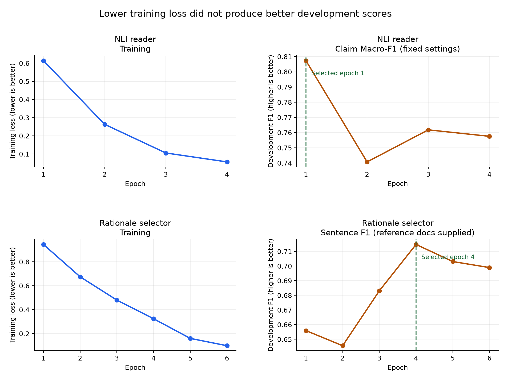

# Overfitting audit — 22 October 2026

There is evidence of late-epoch overfitting and a serious risk of overfitting the
development selection process. The requested >85% accuracy and >0.85 Macro-F1
have not been achieved. The strongest confirmed retrieved-validation result
remains **80.67% / 0.795974** across300 reused validation claims.

The later targets are >95% accuracy and >0.95 Macro-F1; these also remain unmet.
The [new joint-reader experiment](JOINT_READER_EXPERIMENT.md) used separate
gradient-fitting and stopping groups and retained epoch 2 after stopping loss
plateaued. Its reused 163-claim TRAIN audit scored 74.85% /0.743697, missing the
fixed minimum Macro-F1 improvement. It was rejected without a validation-300
run. These controls do not undo the historical selection risk or establish
absence of overfitting.

## Saved learning curves

| Component | Earlier checkpoint | Later checkpoint | Interpretation |
|---|---|---|---|
| Binary rationale selector | Epoch4: train loss0.324637; development rationale F1 0.714754 | Epoch6: train loss0.099087; rationale F1 0.698962 | Lower training loss accompanies worse held-out component F1 |
| Title-aware NLI reader | Epoch1: train loss0.614251; development claim Macro-F1 0.807335 | Epoch4: train loss0.056276; Macro-F1 0.757560 | Same inference thresholds and top3/gate settings; later training generalizes worse |

The selector F1 is a binary sentence component metric. It must not be compared
numerically with three-class claim Macro-F1. The NLI development comparison
holds retrieval and inference cutoffs fixed at the epoch1 recipe. Even the best
separately tuned epoch4 NLI recipe scores only0.769294 Macro-F1.

## Development selection is too extensive

Only120 development claims were used for5,184 coarse selector/reader settings,
2,560 reader refinements and44,544 selector refinements: **52,288 tested settings**
in these three searches alone. They are correlated settings, not52,288 independent
experiments, but selecting the largest development score from this search is
optimistic. The0.841667/0.840411 development result should not be presented as
an expected validation score. Selection overfitting is a known source of biased
performance estimates ([Cawley and Talbot, JMLR2010](https://jmlr.org/papers/v11/cawley10a.html)).

## Refitting does not explain the gap by itself

| Frozen pipeline | Retrieved validation claims | Accuracy | Macro-F1 |
|---|---:|---:|---:|
| Exact development-selected checkpoints | 300 | 74.67% | 0.748624 |
| All-eligible-TRAIN refitted checkpoints | 300 | 76.00% | 0.762882 |
| Previous title-aware full-abstract profile | 300 | **80.67%** | **0.795974** |

Both selector pipelines completed all300 retrieved plus100 separate oracle
checks without operational errors. The original selected weights are worse than
the refit on these cohorts. Reverting the refit does not cure generalization.
The gap between the exact selected pipeline's development and validation is
9.5 percentage points of accuracy; this is descriptive, not a causal estimate.
These validation cohorts have been reused repeatedly and cannot provide a new
blind confirmation. Neither failed selector replaces the better profile.

The fitted source rows have zero exact normalized-text overlap with development
or validation. Same-reference-paper exposure is73/120 development claims versus
172/300 validation claims (60.8% versus57.3%); this modest difference does not
establish the cause of the much larger score gap. Shared papers and related
claim variants still motivate grouping future splits. Distribution differences,
finite-sample variation, evidence selection and reader errors can also contribute.

## Corrections

`src/claim_checker/data/grouped_training.py` builds connected groups using both
shared reference papers and normalized duplicate claim texts. Validation texts
are excluded first. The frozen protocol contains807 eligible TRAIN claims in490
independent groups and five folds. Each run reserves one fold for auditing, a
different fold for stopping, and the remaining folds for fitting. Existing
historical split files and raw predictions are preserved.

`artifacts/improvement/grouped_training_protocol_v1.json` predeclares one
regularized recipe: generic pretrained NLI base, only four final encoder layers
trainable, dropout0.2, weight decay0.05, LR5e-6, and at most four epochs with
patience1 on stopping-pair cross-entropy. Inference cutoffs are fixed; the
threshold-search budget is zero. Audit predictions cannot select the checkpoint.
Final all-TRAIN refitting is disabled pending assessment of all grouped folds.

`scripts/train_regularized_grouped.py` implements that protocol and additionally
excludes stop/audit papers from weak BM25 training negatives. It saves actual
training and stopping rows, integrity hashes, learning curves, the frozen epoch
selection and real application audit predictions. Stopping metrics use supplied
reference documents and are component metrics. The later audit uses genuine
retrieval, without gold references at inference. TRAIN audit scores are not the
requested validation300 result, and no new blind dataset is claimed.

Machine-readable diagnosis: `artifacts/improvement/overfitting_audit.json`.
Learning curves and source prediction hashes are retained there. Three regression
tests verify transitive groups, validation-text exclusion, paper-disjoint folds,
determinism and rejection of non-TRAIN source claims.

## First controlled grouped run

The first fold completed fitting on484 claims/1,345 pairs and stopping on160
claims/292 annotated pairs. The saved source-row audit found zero text or paper
overlap across fit/stop/audit, zero validation-text overlap, zero source or label
mismatches, and matching frozen data hashes. Its457 BM25 negative pairs have
weak labels; held-out papers were excluded from those pairs too.

| Epoch | Weighted training loss | Unweighted stopping loss | Stopping pair Macro-F1 |
|---|---:|---:|---:|
| 1 | 0.834514 | 0.597825 | 0.789673 |
| 2 | 0.606343 | 0.466670 | 0.830213 |
| 3 | 0.559741 | 0.435447 | 0.828430 |
| 4 | 0.543878 | 0.419594 | 0.841024 |

Stopping loss improved every epoch, so the four-epoch cap ended training and
epoch4 was frozen before application auditing. The patience rule did not fire.
Training and stopping losses use different weighting and must not be interpreted
as a directly comparable numerical gap. These stopping scores use supplied
reference documents and are not claim-level retrieval results.

The subsequent genuine-retrieval application audit scored **72.39% accuracy /
0.725585 Macro-F1**,118/163 correct, with zero operational errors. Its219/219
quotations were exact source text; cited-sentence precision/recall were
0.545455/0.371134. This is a stricter grouped TRAIN population, not the existing
validation300 cohort, and the model fitted fewer claims. Directly ranking its
score against80.67% on validation300 would be inappropriate. It does not establish
that overfitting has been cured or that either requested target is met.

Only **one of five** grouped folds has been run. No full grouped estimate or
all-TRAIN refit is claimed. The original application default and better confirmed
validation profile are preserved. The model, frozen selection, actual audit
predictions, copied training source and protocol are in
`artifacts/models/regularized_grouped_v1_fold0`. The partial summary is
`artifacts/improvement/regularized_grouped_summary.json`. All333 regression tests
pass, and Ruff passes across source, UI, scripts and tests.
