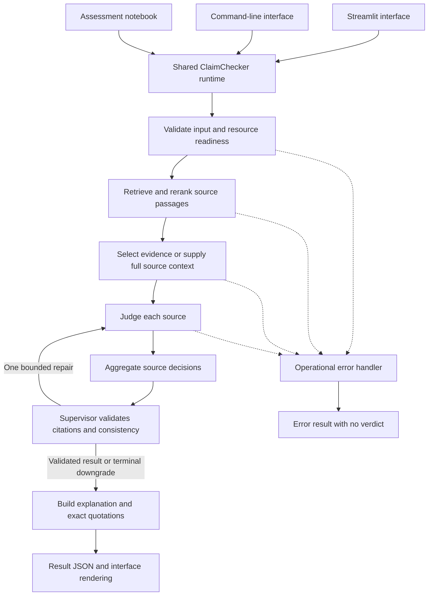

# Scientific Claim Checker

A local application that checks a scientific claim against retrieved source passages and returns **SUPPORT**, **CONTRADICT**, or **NEI** with exact quotations, source references, and an explanation.

The project implements the P08 “Scientific Claim Checker: Retrieve, Read and Judge” brief using Streamlit, LangGraph, hybrid retrieval, and locally hosted models. The CLI, web interface, and assessment notebook share the same Python package.

**Current measured status:** the strongest saved profile achieves **80.67% accuracy / 0.7960 Macro-F1 on all 300 SciFact validation claims**. The requested >95% targets remain unmet. These validation claims have been reused during development and are not a blind test.

## Contents

- [Features and scope](#features-and-scope)
- [Architecture](#architecture)
- [Implementation details](#implementation-details)
- [Repository structure](#repository-structure)
- [Setup and first run](#setup-and-first-run)
- [Optional model profiles](#optional-model-profiles)
- [General science mode](#general-science-mode)
- [Evaluation and measured results](#evaluation-and-measured-results)
- [Testing and continuous integration](#testing-and-continuous-integration)
- [Implementation plan](#implementation-plan)
- [Preparing a GitHub push](#preparing-a-github-push)
- [Limitations and documentation](#limitations-and-documentation)

## Features and scope

- Search the **5,183-abstract SciFact collection** with BM25, dense retrieval, or hybrid reciprocal rank fusion, with optional cross-encoder reranking.
- Run an evidence agent, judge, deterministic aggregator, supervisor, and explainer through a bounded LangGraph workflow.
- Copy quotations from stored sentence IDs rather than accepting generated quotation text.
- Inspect source passages, pipeline events, timings, conflicts, and downloadable result JSON in Streamlit.
- Evaluate fixed claim populations with baselines, oracle diagnostics, and ablations.
- Use optional local NLI readers, trained evidence selectors, and experimental LoRA models.
- Switch to a separate **general-science collection** covering selected physics, chemistry, biology, astronomy, and water-science material.

NEI means the available collection does not establish a decisive answer. It does not mean the claim is false. Operational failures produce `status="error"` and no verdict.

## Architecture



The agents are explicit pipeline roles. The default generative evidence and judge calls share a local Ollama model; aggregation, citation validation, and explanation assembly are code. Optional NLI profiles change the reader backend while retaining the shared application contracts.

### Retrieval path

```text
Claim
  ├─ BM25 keyword ranking ────────────────┐
  └─ BGE query embedding → dense ranking ─┤
                                         ↓
                              Reciprocal rank fusion
                                         ↓
                              Cross-encoder reranking
                                         ↓
                              Top-k source documents
```

The default profile retrieves 30 candidates per method, uses RRF with `k=60`, reranks 20 candidates, retains 10 hits, and examines the top three. Dense search uses a NumPy vector matrix; this implementation does not use FAISS. Long abstracts are represented by sentence-aware windows and aggregated back to document IDs.

### Model and agent responsibilities

| Component | Responsibility | Main implementation |
|---|---|---|
| Runtime | Lazy resource loading, readiness, shared CLI/UI/notebook entry point | `src/claim_checker/runtime.py` |
| Retriever | BM25, dense windows, RRF, reranking and index identities | `src/claim_checker/retrieval/` |
| Evidence agent | Return valid sentence IDs from a supplied source | `agents/evidence.py`, `agents/trained_evidence.py` |
| Judge | Decide whether a source supports, contradicts, or is insufficient | `agents/judge.py`, `agents/judge_nli.py`, `agents/judge_lora.py` |
| Aggregator | Combine source verdicts and expose conflicts | `pipeline/aggregate.py` |
| Supervisor | Validate citations, bound repairs, handle unsupported decisions | `pipeline/supervisor.py`, `pipeline/graph.py` |
| Explainer | Assemble a readable result from validated decisions | `agents/explainer.py` |
| Evaluation runner | Resume compatible runs and compute explicit metrics | `evaluation/runner.py`, `evaluation/metrics.py` |

Paths in the last six rows are relative to `src/claim_checker/`. Further implementation details are in [ARCHITECTURE.md](Docs/ARCHITECTURE.md).

## Implementation details

### Data acquisition and contracts

The SciFact preparation flow attempts the named Hugging Face sources, checks corpus IDs and annotations, and records upstream revisions/checksums. When the legacy claims loader is unsupported, it uses the documented official-archive/JSON compatibility route. Remote dataset Python is not executed.

Prepared records retain document IDs, titles, original sentence boundaries, claim labels, and evidence sentence IDs. Frozen split manifests define the evaluated populations. The historical assessment subset contains 100 validation claims, seed 42; later experiments also evaluate the additional 200 and report the full 300 separately.

Data contracts and the acquisition fallback are documented in [DATA_CONTRACTS.md](Docs/DATA_CONTRACTS.md).

### Structured generation and quotations

- Default model: `qwen3:4b` through the local Ollama endpoint.
- Default endpoint: `http://127.0.0.1:11434`; configuration accepts loopback endpoints only.
- Model responses are constrained with JSON schemas and validated with Pydantic.
- Evidence and judge outputs identify sentence IDs; application code copies the quotation from the source.
- Invalid schemas or citation IDs receive a bounded repair attempt.
- A decisive judgment without valid evidence can be downgraded to NEI after the permitted repair.

Exact quotation matching establishes source traceability. It does not establish that the passage is relevant or that the judgment is correct.

### Aggregation and failure handling

| Usable source decisions | Claim result |
|---|---|
| SUPPORT present, no CONTRADICT | SUPPORT |
| CONTRADICT present, no SUPPORT | CONTRADICT |
| Only NEI, or no usable decisive source | NEI |
| Both SUPPORT and CONTRADICT | NEI with `conflict=true` |
| Operational failure | `status="error"`, `verdict=null` |

Prompt/context limits, input validation, and graph recursion bounds prevent unbounded execution. Confidence values are uncalibrated model outputs.

### Reproducibility and caching

Run identities record configuration, prompts, model identity, data/split identity, and index fingerprint. Compatible evaluation runs resume completed claims; changed identities require a new run ID. LLM and retrieval caches remain local. Cached and cold timing measurements must be distinguished.

Several research protocols hash source and configuration bytes. `.gitattributes` preserves those bytes across checkouts; Markdown and SVG documentation use LF line endings.

## Repository structure

```text
.
├── .github/workflows/       # CPU lint/test workflow
├── .streamlit/             # UI configuration; secrets are ignored
├── configs/                # Default, experiments and optional reader profiles
├── data/
│   ├── examples/           # Small project-authored general-science smoke examples
│   ├── sources/            # Attributed, verified USGS excerpt
│   ├── splits/             # Frozen population manifests
│   ├── raw/                # Downloaded sources; only source manifest is versioned
│   └── processed/          # Prepared datasets; only data-quality summary is versioned
├── Docs/                   # Architecture, evaluation, audits, plans and figures
├── notebooks/              # Main assessment notebook
├── prompts/                # Evidence/judge templates and experimental prompts
├── scripts/                # Acquisition, training, evaluation and audit utilities
├── src/claim_checker/      # Shared application package
├── tests/                  # Offline fixtures and regression tests
├── ui/                     # Streamlit application and assets
└── artifacts/              # Local runtime/research outputs; selected summaries versioned
```

Model weights, downloaded datasets, indexes, raw prediction streams, logs, local dependencies, executed-notebook backups, and maintenance inventories are excluded from Git. Experiment scripts remain because they implement or reproduce documented runs; a rejected experiment is not automatically disposable code.

## Setup and first run

### Prerequisites

- Python **3.11 or newer**. CI targets Python 3.11; the original workstation used conda Python 3.14.6.
- Git, an internet connection for initial data/model downloads, and [Ollama](https://ollama.com/) for the default generative backend.
- CPU execution is supported. GPU training is optional and requires a matching PyTorch build.

Run the following from the repository root in **Anaconda Prompt or Windows Command Prompt**. `Set-Location` is a PowerShell command and is not used here.

```bat
conda create -n scientific-claims python=3.11 -y
conda activate scientific-claims
python -m pip install --upgrade pip
python -m pip install torch --index-url https://download.pytorch.org/whl/cpu
python -m pip install -e ".[dev]"
```

`requirements.lock.txt` records the original workstation's direct dependency versions. It is not a complete cross-platform lockfile; use `pyproject.toml` for a fresh environment. For CUDA, select the matching build using the [PyTorch installer](https://pytorch.org/get-started/locally/).

### Start Ollama and obtain the model

In a separate terminal, start the server if the Ollama application is not already serving:

```bat
ollama serve
```

In the project terminal:

```bat
ollama pull qwen3:4b
python -m claim_checker prepare-data
python -m claim_checker build-index
python -m claim_checker doctor
python -m claim_checker check --claim "Your scientific claim." --json
```

Initial preparation downloads data and models. Later checks can run offline once all required resources are cached. Rebuilding an index or running experiments may take substantially longer than a single warm check.

### Launch the interface or notebook

```bat
python -m streamlit run ui/app.py --server.address 127.0.0.1
```

The interface provides collection selection, claim checking, source/evidence inspection, settings, readiness checks, history, and saved evaluation summaries. To open the assessment notebook:

```bat
python -m jupyter lab notebooks/Scientific_Claim_Checker.ipynb
```

The notebook combines saved historical evaluations with explicitly marked live demonstrations and later experiment notes. Its Module 2/3 adaptation appendix was checked separately; a fresh execution of every historical model cell is not implied. See [LAB_REUSE.md](Docs/LAB_REUSE.md).

## Optional model profiles

```bat
python -m pip install -e ".[verifier,lora,general-science]"
```

| Profile | Purpose | Resource requirement |
|---|---|---|
| `configs/default.yaml` | Default Ollama agent workflow | Local `qwen3:4b`, prepared SciFact data/index |
| `configs/verifier_title_candidate.yaml` | Strongest confirmed SciFact NLI alternative | Saved title-aware trained checkpoint |
| `configs/trained_evidence_candidate.yaml` | Trained sentence selector plus NLI | Saved selector and verifier checkpoints |
| `configs/lora_candidate.yaml` | Experimental generative LoRA judge | Matching local base model and adapter |
| `configs/general_science.yaml` | Separate general-science collection | Generic large NLI base, separate data/index |

**Trained checkpoints are not included in Git.** Optional trained profiles require the referenced local weights and their matching provenance. They are not automatically reconstructed by installing the Python package. Historical workflow scripts also depend on earlier-stage artifacts; consult their frozen protocols before running them.

With the title-aware checkpoint available:

```bat
python -m claim_checker --config configs/verifier_title_candidate.yaml check --claim "Your scientific claim."
set "CLAIM_CHECKER_CONFIG=configs/verifier_title_candidate.yaml"
python -m streamlit run ui/app.py --server.address 127.0.0.1
```

Restart Streamlit after changing the environment-selected profile. Clear it with `set "CLAIM_CHECKER_CONFIG="` to use the default again.

## General science mode

This collection is separate from SciFact. The saved build contains **14,056 passages** from OpenStax textbook material and one attributed USGS excerpt. It has finite coverage and performs no live web search during claim checking.

For a fresh local build, install the optional dependencies above and download the pinned generic NLI base:

```bat
python -c "from huggingface_hub import snapshot_download; snapshot_download(repo_id='MoritzLaurer/DeBERTa-v3-large-mnli-fever-anli-ling-wanli', revision='b3546ea6b0346eb6f8d5d68b13c7dc6d0376b3d7', local_dir='artifacts/models/nli_large_base', allow_patterns=['*.json','*.safetensors','*.model','README.md','LICENSE*'])"
python -m scripts.prepare_general_science --download
python -m scripts.prepare_usgs_science --verified-excerpts
python -m claim_checker --config configs/general_science.yaml build-index
python -m claim_checker --config configs/general_science.yaml check --claim "Water is a Universal Solvent"
```

The first generic-model download is large. Cached OpenStax revisions are preserved locally; a fresh acquisition may capture newer upstream revisions and produce a different passage count. The USGS command uses the versioned, attributed excerpt rather than claiming a successful live crawl.

The saved profile returned SUPPORT for “Water is a Universal Solvent” and CONTRADICT for “Water dissolves every substance.” These wording checks do not establish general-science accuracy. See [GENERAL_SCIENCE.md](Docs/GENERAL_SCIENCE.md) for provenance, source terms, and the smoke evaluation.

## Evaluation and measured results

| System | Population | Accuracy | Macro-F1 | Interpretation |
|---|---|---:|---:|---|
| Default Qwen product | Historical 100 SciFact validation claims | 68.00% | 0.6621 | Original product result |
| Title-aware NLI profile | All 300 original SciFact validation claims | **80.67%** | **0.7960** | Strongest confirmed full-300 result; reused population |
| Latest all-layer LoRA candidate | Separate 163-claim TRAIN audit | 74.23% | 0.7307 | Rejected by its frozen gate; no validation-300 run |
| General-science profile | 15 developer-written smoke examples | 93.33% | 0.9327 | Small demo set; not an independent benchmark |

The rows use different populations and are not a model leaderboard. Audit scores cannot be substituted for validation scores. Neither >95% accuracy nor >0.95 Macro-F1 has been established. Exact quotations and passing tests are separate from predictive quality.

### Run evaluations

Use a new run ID when configuration or code changes:

```bat
python -m claim_checker retrieval-eval --split final
python -m claim_checker evaluate --suite smoke --run-id smoke_local_v1
python -m claim_checker evaluate --suite final --run-id final_local_v1
python -m claim_checker report --run-id final_local_v1
```

The `final` suite runs the original named baselines and ablations, including v1 `full`; it does not implicitly select the later v2 product. To evaluate the default v2 product explicitly on the same population:

```bat
python -m claim_checker evaluate --suite final --run-id product_local_v2 --variants full_v2_nothink oracle_v2
```

- Verdict accuracy includes every requested claim; operational errors count as wrong.
- Macro-F1 reports SUPPORT, CONTRADICT, and NEI performance.
- Retrieval reports reference Recall@3/@10 and separate evidence-bearing recall.
- Evidence precision/recall uses annotated sentence IDs. Unannotated documents are not proven irrelevant; their selected sentences are reported separately and excluded from precision.
- Oracle runs receive reference abstracts solely for component diagnosis and remain separate from retrieved results.
- Cold latency and cached response timing must be reported separately.

See [EVALUATION.md](Docs/EVALUATION.md), [accuracy experiments](Docs/ACCURACY_IMPROVEMENT_2026-10-22.md), and the versioned summaries in `artifacts/` for definitions and historical results. Full raw runs remain local.

## Testing and continuous integration

Install `dev`, `verifier`, `lora`, and `general-science` extras to exercise the complete optional test surface:

```bat
python -m pip install -e ".[dev,verifier,lora,general-science]"
python -m ruff check --no-cache src ui scripts tests
python -m pytest -q -p no:cacheprovider
```

The complete workstation regression run passed **434 tests**. The GitHub preparation check also ran the suite from an export containing only publishable files: **433 passed, one skipped**. That optional integration check needs a cached Qwen tokenizer, which is intentionally absent from a clean export. The remaining offline tests use synthetic fixtures, tiny locally constructed models, and mocked services. They do not need downloaded project checkpoints or a running Ollama server. Optional tests may skip when dependencies or their explicitly required local resources are absent.

GitHub Actions installs CPU PyTorch and the optional test dependencies, runs Ruff, and executes tests with `HF_HUB_OFFLINE=1`. Hosted CI status is available only after the workflow runs on GitHub. The original workstation's CUDA/PEFT dependency overlays under `tmp/` are local and are not installation requirements for a clone.

## Implementation plan

| Phase | Scope and implementation | Status / acceptance evidence |
|---|---|---|
| 1. Data foundation | Acquisition fallback, normalization, annotation checks, manifests and frozen splits | Implemented in `data/`; recorded data-quality checks |
| 2. Retrieval | BM25, sentence-window dense search, RRF, cross-encoder reranking and fingerprints | Implemented in `retrieval/`; retrieval comparisons available |
| 3. Agent workflow | Structured evidence/judgment, aggregation, supervisor repairs and exact citations | Implemented in `agents/` and `pipeline/`; regression coverage |
| 4. User interfaces | Shared runtime, CLI, Streamlit claim/source views and assessment notebook | Implemented; local data/models required for live use |
| 5. Evaluation | Baseline/full/oracle/ablation runs, metrics, resumability and failure analysis | Implemented; populations and reuse disclosed |
| 6. General science | Separate OpenStax/USGS corpus, provenance, profile and benchmark handling | Implemented; representative accuracy remains unestablished |
| 7. Model improvement | NLI, evidence selectors, grouped training, joint reader and LoRA experiments | Implemented experiments; several rejected; >95% targets unmet |
| 8. Next accuracy experiment | Learn claim-level aggregation from reader-out-of-fit TRAIN predictions | Proposed; keep reader/retrieval fixed for the first comparison |
| 9. Stronger generalization check | Separate outer paper/text groups, verified hard-case data and a new locked evaluation | Planned; existing reused scores cannot establish absence of overfitting |
| 10. Coursework completion | Exact lab citations and reproducible presentation/notebook review | Module 2/3 appendix added; referenced Module 4/judging files remain unavailable |

The next research sequence is documented in [REACH_95_APPROACH.md](Docs/REACH_95_APPROACH.md): claim-level calibration, checked evidence-aligned training examples, scientific reranking, and selective rationale sets. Each change needs a controlled comparison. A proposed architecture is not a guaranteed score.

## Preparing a GitHub push

`.gitignore` keeps large/local resources out of the first commit while retaining code, configs, prompts, the assessment notebook, source/split manifests, and selected evaluation summaries. It also excludes credentials, logs, generated metadata, local handoffs, and dependency bundles. Ignoring a file does not delete its local copy.

GitHub blocks ordinary Git files larger than 100 MiB; use appropriate external model storage or Git LFS if deliberately distributing checkpoints. See [GitHub's large-file documentation](https://docs.github.com/en/repositories/working-with-files/managing-large-files/about-large-files-on-github). This repository's default publishing policy excludes checkpoints.

After creating an empty GitHub repository, replace the example URL below with your own. Review the staged list before committing:

```bat
git init
git branch -M main
git add .
git status --short
git diff --cached --stat
git commit -m "Add scientific claim checker application and research documentation"
git remote add origin https://github.com/YOUR_USERNAME/YOUR_REPOSITORY.git
git push -u origin main
```

These commands describe a first push. If a Git repository already exists, inspect its branch, staged files and remotes before using initialization/remote commands. `.gitignore` does not remove files already tracked in an existing repository.

## Limitations and documentation

- Scientific coverage is bounded by the selected local collection; the application does not establish scientific consensus or study quality.
- Biomedical models can mishandle entities, scope, numerical effects, negation, and related but insufficient evidence.
- All existing validation-300 results are reused development evidence. Regularization and early stopping do not prove absence of overfitting.
- The latest LoRA candidate improved citation recall but worsened precision; it was rejected. The original best profile remains available.
- Some historical experiment scripts require local prerequisite records and weights not shipped in Git.
- This checkout records dependency and upstream data/model provenance. Preserve publisher attribution and consult each upstream source's terms when redistributing its material. No project-wide software license has yet been selected.

| Document | Contents |
|---|---|
| [Architecture](Docs/ARCHITECTURE.md) | Components, graph, model calls and data flow |
| [Runbook](Docs/RUNBOOK.md) | Operations, offline use and troubleshooting |
| [Data contracts](Docs/DATA_CONTRACTS.md) | Dataset acquisition and normalized record definitions |
| [Evaluation](Docs/EVALUATION.md) | Metrics, baselines, ablations and historical measurements |
| [Accuracy experiments](Docs/ACCURACY_IMPROVEMENT_2026-10-22.md) | Detailed experiment history and population provenance |
| [Overfitting audit](Docs/OVERFITTING_AUDIT_2026-10-22.md) | Training curves and selection-overfitting findings |
| [Latest LoRA experiment](Docs/LORA_SCIENCE_EXPERIMENT.md) | Frozen recipe, audit results and rejection |
| [General science](Docs/GENERAL_SCIENCE.md) | Collection scope, attribution and smoke evaluation |
| [Next accuracy approach](Docs/REACH_95_APPROACH.md) | Proposed experiments and controls |
| [Lab reuse](Docs/LAB_REUSE.md) | Actual source-cell citations and remaining gaps |
| [Limitations](Docs/LIMITATIONS.md) | Task, evidence and evaluation limitations |
